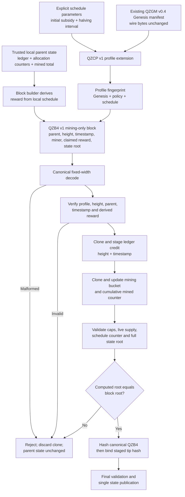

# CP-0398 — Profile-Bound Atomic v0.4 Mining Transition

**Status:** Candidate-only specification and implementation. Not connected to node runtime, PoW admission, transactions, fork choice, durable snapshots, or production networking.
**Base commit:** `9f965b4030f80319a7e3a699b31a04aad7caa99a`
**Consensus gates:** Gate 2 OPEN. Gate 8 OPEN.

## Architecture diagram

## Implemented files

- `src/native/pow_bench/src/monetary_transition_v04_candidate.rs`: QZCP profile extension, QZB4 mining-only block, profile-bound state, builder, importer transition, and apply summary.
- `src/native/pow_bench/src/state_machine.rs`: two `pub(crate)` helpers that stage the account/height/timestamp changes and finalize a tip hash after block ID calculation. No public mint API was added.
- `simulations/quantumzxb_v04_transition_profile_vectors.py` and `simulations/quantumzxb_v04_transition_profile_vectors.txt`: independent Python standard-library oracle and vectors.
- `.github/workflows/rust-ci.yml`: CI verifies the new independent oracle before formatting/check/test.

## Versioned profile and block contract

### QZCP v1 — 254 bytes

The separate profile extension binds the exact QZGM manifest hash, network ID, original Genesis root, v0.4 allocation-policy fingerprint, explicit schedule parameters, schedule fingerprint, profile fingerprint, and a domain-separated checksum.

The decoder always requires the expected `GenesisManifestV04` and reconstructs the profile from its explicit parameters. A different Genesis, altered bytes, unknown version, or schedule/profile fingerprint mismatch fails closed. Existing QZGM and QZL4 bytes are not reinterpreted.

### QZB4 v1 — 166 bytes

The fixed-width candidate mining envelope includes profile fingerprint, height, timestamp, parent hash, miner account, claimed subsidy, and declared post-state root. Its block ID is a domain-separated SHA-256 of the canonical encoded envelope.

QZB4 deliberately represents **mining issuance only**. It does not include user transactions or a proof-of-work proof, and the current MBK3/MBK4/PMT3/PMT4 runtimes do not accept it.

## Atomic transition invariants

1. The builder derives subsidy only from the local parent state's mined counter, the height, and the explicitly supplied profile schedule.
2. The importer independently derives the same expected subsidy and rejects a peer-supplied value that differs.
3. Ledger credit is staged on a clone. Allocation accounting and cumulative mining counters are staged separately on clones.
4. The candidate verifies bucket limits, total gross supply, live supply versus account balances, schedule-issuance bounds, and the profile-bound state root before publishing any mutation.
5. The block ID is computed only after the state root has validated. The staged ledger tip is finalized against the exact parent, then the complete candidate is revalidated and published once.
6. Any failure—bad profile, height, parent, timestamp, claimed reward, accounting invariant, or state root—returns before assigning the staged candidate to the receiver. Tests compare the receiver to its original state after rejection.

The profile-bound state root commits to the profile fingerprint, underlying deterministic ledger root, allocation-accounting commitment, and cumulative mined atoms. It remains distinct from the original QZGM initial root by design: QZCP is a separately versioned extension rather than a silent change to QZGM.

## Independent vectors

The current vector fixture uses **10,000 atoms initial subsidy and a two-block halving interval solely as test data**. These values are not proposed network economics and must not be used as activation defaults.

The independent Python oracle currently reproduces:
- the canonical QZGM manifest hash and original Genesis root;
- the QZCP profile fingerprint and exact 254-byte profile encoding;
- the profile-bound Genesis state root;
- first-block ledger root, updated accounting bytes and profile-bound state root;
- exact QZB4 first-block bytes and block ID.

These are cross-language consistency vectors, not a security audit or an external anti-rollback guarantee.

## Validation status

This candidate's six targeted Rust tests cover profile/Genesis binding, fixed-width canonical codecs, producer/importer parity across a halving boundary, reward forgery rejection, profile downgrade/mismatch, and atomic rejection for wrong root/parent/timestamp/height/account. The independent Python oracle is also wired into CI.

Local Windows validation on the uncommitted CP-0398 worktree passed `cargo fmt --all -- --check`, both CP-0397 and CP-0398 oracle `--check` commands, `cargo check --all-targets --locked --offline` (exit code 0), and `cargo test --all-targets --locked --offline -- --test-threads=1` (exit code 0). The library group reports 803 passed / 0 failed in 439.09 seconds; `devnet_node` reports 36 passed / 0 failed, and `private_testnet_node` reports 36 passed / 0 failed. All remaining binary, integration, and example targets also completed without failures. Existing unrelated unused-import/dead-code warnings remain in other modules.

These are local results, not CI for the eventual CP-0398 commit. Its new SHA must receive its own complete GitHub Actions result after push before that SHA can be called CI-green.

## Explicit remaining blockers

- No approved v0.4 economic schedule is selected. The test-only numbers are not defaults.
- QZCP is not yet integrated into the actual node Genesis loader or profile activation/selection.
- QZB4 has no PoW, transactions, mempool, consensus/fork-choice adapter, or network envelope.
- The profile-bound state has no dedicated durable snapshot/recovery format yet; QZL4 remains the older candidate snapshot format and does not encode QZCP.
- No node producer/importer runtime calls this module, and legacy PMT3/PMT4 behavior remains unchanged.
- Anti-rollback still requires a separately operated external CAS/anchor, verified receipts, and stale-snapshot/crash/recovery tests.

No issuance, network activation, mainnet readiness, launch or income claim follows from this candidate.